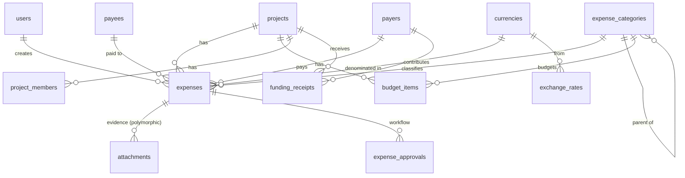

# ລະບົບເກັບກຳລາຍຈ່າຍໂຄງການ (Project Expense Tracking System)
## ບົດວິເຄາະໄຟລ໌ `Payment_Solar_3_MW.xlsx` + ການອອກແບບຖານຂໍ້ມູນ ແລະ ສະຖາປັດຕະຍະກຳ

**Stack:** Laravel (API) + Vue 3 (SPA) + MySQL 8 + S3-compatible storage
**ວັນທີ:** 2026-08-25

---

# ພາກທີ 1 — ບົດວິເຄາະໄຟລ໌ Excel

## 1.1 ໂຄງສ້າງໄຟລ໌

ໄຟລ໌ຂະໜາດ **55.9 MB** ປະກອບດ້ວຍ 7 sheets:

| Sheet | ຂະໜາດ | ບົດບາດຕົວຈິງ |
|---|---|---|
| `Payment` | 89 × 13 | ຕາຕະລາງລາຍຈ່າຍ **ສະບັບເກົ່າ** (76 ລາຍການ) |
| `ຕົ້ນທຶນ` | 14 × 11 | **ງົບປະມານ/ຄາດຄະເນ** (BOQ) 11 ລາຍການ, USD 1,493,145 |
| `Sheet2` | 77 × 16 | ການຄິດໄລ່ **ຄວາມເປັນໄປໄດ້ທາງການເງິນ** (Load factor, ROI, ດອກເບ້ຍ, EDL payment) |
| `ຫລັກຖານການຈ່າຍ` | 686 × 9 | **ຮູບໃບຫຼັກຖານ 65 ຮູບ** (ບໍ່ມີຂໍ້ຄວາມເລີຍ) |
| `Payment new` | 340 × 16 | ຕາຕະລາງລາຍຈ່າຍ **ສະບັບປັດຈຸບັນ** (318 ລາຍການ) ← ແຫຼ່ງຂໍ້ມູນຫຼັກ |
| `Report` | 46 × 26 | ລາຍງານສະຫຼຸບຕາມໝວດ (USD + LAK) + chart |
| `Sheet1` | 28 × 8 | ລາຍງານຕາມຜູ້ຈ່າຍ + ສະຫຼຸບ 3 ໂຄງການ |

**ຂໍ້ສັງເກດສຳຄັນ:** ໄຟລ໌ນີ້ 98% ຂອງຂະໜາດແມ່ນ **ຮູບພາບ** (65 ຮູບ PNG, ບາງຮູບໃຫຍ່ເຖິງ 2.5 MB). ນີ້ຄືເຫດຜົນຫຼັກທີ່ຕ້ອງຍ້າຍໄປລະບົບຖານຂໍ້ມູນ — Excel ບໍ່ໄດ້ຖືກອອກແບບມາເພື່ອເປັນ document store.

## 1.2 ໂຄງສ້າງຄໍລຳຂອງ `Payment new` (ຕາຕະລາງຫຼັກ)

```
ລຳດັບ | ວັນ/ເດືອນ/ປີ | ລາຍການ(=ໝວດ) | ລາຍລະອຽດ | ຫົວໜ່ວຍ | ຈຳນວນ
      | ເງີນກີບ | ເງິນບາດ | ເງິນໂດລາ | ອັດຕາແລກປ່ຽນ | ຍອດລວມ | ຜູ້ຈ່າຍ
```

## 1.3 ຕົວເລກສະຫຼຸບທີ່ຄິດໄລ່ໄດ້ (318 ລາຍການ)

| ລາຍການ | ຄ່າ |
|---|---|
| ຊ່ວງວັນທີ | 2024-01-21 ຫາ 2026-08-21 |
| ລວມ ກີບ | 6,559,489,394.82 LAK (299 ລາຍການ) |
| ລວມ ບາດ | 1,943,980 THB (10 ລາຍການ) |
| ລວມ ໂດລາ | 361,367.73 USD (314 ລາຍການ) |
| ອັດຕາແລກປ່ຽນທີ່ພົບ | 21,000 – 22,508 (LAK/USD) ແລະ 31.2 – 32.78 (THB/USD) |

**ຕາມໝວດ (USD):**
| ໝວດ | ຈຳນວນລາຍການ | ຍອດ USD |
|---|---|---|
| *(ບໍ່ໄດ້ລະບຸໝວດ)* | **80** | **129,331** |
| ອຸປະກອນຕ່າງໆ | 92 | 114,598 |
| ຄ່າແຮງ | 53 | 39,421 |
| ຄ່າໃຊ້ຈ່າຍຕ່າງໆ | 27 | 32,323 |
| ຄ່າມັດຈໍາ | 1 | 30,000 |
| ຄ່າເຊົ່າ | 8 | 6,161 |
| ສັນຍາ | 1 | 5,000 |
| ນ້ຳມັນ | 21 | 1,399 |
| EDL | 6 | 996 |
| ອາຫານ | 11 | 707 |
| ຄ່າທຳນຽມ / ບໍລິຫານ / ຄ່າສ້ອມແປງ / ຄ່າໄຟຟ້າ / ຄ່າຂົນສົ່ງ | 18 | 1,430 |

**ຕາມຜູ້ຈ່າຍ (USD):** Sinexay 153,364 | SSS 136,783 | Sengsamai 71,221

## 1.4 ບັນຫາຄຸນນະພາບຂໍ້ມູນທີ່ພົບ (ນີ້ຄືເຫດຜົນຫຼັກຂອງການສ້າງລະບົບ)

### 🔴 ຮ້າຍແຮງ

**1. ຄໍລຳ "ອັດຕາແລກປ່ຽນ" ບັນຈຸ 2 ຄວາມໝາຍໃນຄໍລຳດຽວ**
- ແຖວ LAK → ຄ່າ 21,000–22,508 (LAK ຕໍ່ 1 USD)
- ແຖວ THB → ຄ່າ 31.2–32.78 (THB ຕໍ່ 1 USD)

ບໍ່ມີທາງຮູ້ໄດ້ຈາກຂໍ້ມູນວ່າ rate ນັ້ນເປັນຂອງສະກຸນໃດ ນອກຈາກເດົາຈາກຂະໜາດຕົວເລກ. ນີ້ຄື anti-pattern ຄລາສສິກ.

**2. ພົບຂໍ້ຜິດພາດການພິມທີ່ເຮັດໃຫ້ຕົວເລກຜິດ 10 ເທົ່າ**
```
ແຖວ 155 | 2026-02-18 | ເງີນເດືອນ ພະນັກງານ ທ້າວ ດຳ
LAK 12,500,000 | rate = 2117  ← ຄວນເປັນ 21170
→ ບັນທຶກເປັນ USD 5,904.58  ແທນທີ່ຈະເປັນ ~USD 590
```
ຄວາມຜິດພາດອັນດຽວນີ້ = **+5,314 USD** ໃນລາຍງານ.

**3. ຮູບຫຼັກຖານ 65 ຮູບບໍ່ໄດ້ຜູກກັບລາຍການໃດເລີຍ**
ຮູບຖືກ paste ລອຍໆໃສ່ sheet `ຫລັກຖານການຈ່າຍ` (anchor ຢູ່ຕາມແຖວຕ່າງໆ) ໂດຍບໍ່ມີເລກອ້າງອີງ. ຖ້າຜູ້ກວດສອບຖາມວ່າ "ລາຍການທີ 73 ຄ່າເສົາໄຟຟ້າ 131,940,000 ກີບ ມີໃບໂອນບໍ?" → ຕ້ອງເປີດເລື່ອນຫາດ້ວຍຕາ.

ນອກຈາກນັ້ນ ຫຼັກຖານບໍ່ໄດ້ເປັນປະເພດດຽວ — ຂ້ອຍເປີດເບິ່ງແລ້ວມີທັງ **ໃບໂອນເງິນທະນາຄານ**, **ພາບໜ້າຈໍການຈອງໂຮງແຮມ (THB 2,265 — ກົງກັບແຖວ 17 "ຄ່າວິຊາການໄທ")**, ແລະ ໃບບິນຮ້ານຄ້າ. ລະບົບຕ້ອງຮອງຮັບ **ຫຼາຍໄຟລ໌ຕໍ່ 1 ລາຍການ** ແລະ **ຫຼາຍປະເພດຫຼັກຖານ**.

### 🟡 ປານກາງ

| ບັນຫາ | ຈຳນວນ | ຜົນກະທົບ |
|---|---|---|
| ບໍ່ໄດ້ລະບຸໝວດ (`ລາຍການ` ຫວ່າງ) | 80 ແຖວ | 129,331 USD (36%) ຕົກໃສ່ "ບໍ່ຮູ້ໝວດ" — ລາຍງານ chart ບໍ່ມີຄວາມໝາຍ |
| ວັນທີເປັນ text ບໍ່ແມ່ນ date | 6 ແຖວ | `10.11.2025`, `26/1/.2025` — sort/filter ຜິດ |
| ບໍ່ມີຈຳນວນເງິນເລີຍ | 4 ແຖວ | ແຖວຂີ້ເຫຍື້ອ |
| ຊື່ຜູ້ຈ່າຍບໍ່ສະໝ່ຳສະເໝີ | — | `SSS` vs `SSS ` (ມີ space), `Sengsamai` vs `Saengsamai` |
| ເລກລຳດັບຊ້ຳ | — | ເລກ 49 ປາກົດ 2 ເທື່ອໃນ sheet `Payment` |
| ວັນທີພິມຜິດປີ | — | `23.12.2026` ໃນ sheet ເກົ່າ (ຢູ່ກາງລາຍການປີ 2025) |
| ຍອດລວມບໍ່ກົງກັນລະຫວ່າງ sheet | — | `Payment new` = 361,367.73 USD ແຕ່ `Sheet1` = 357,019.87 USD (ຕ່າງ 4,348) |
| `Report` ເປັນ snapshot ຄ້າງ | — | ຄິດເຖິງ 2026-05-09 ເທົ່ານັ້ນ (232,036 USD) ແຕ່ຂໍ້ມູນມີເຖິງ 2026-08 |
| ຄ່າ LAK ມີທົດສະນິຍົມ | — | 6,559,489,394.**82** ກີບ — ກີບບໍ່ມີຫົວໜ່ວຍຍ່ອຍ, ນີ້ຄື float rounding error ຈາກ Excel |

## 1.5 ຄວາມຕ້ອງການທີ່ສະກັດອອກມາໄດ້ (Derived Requirements)

ຈາກໄຟລ໌ຕົວຈິງ ບໍ່ແມ່ນຈາກການເດົາ:

1. **Multi-project** — `Sheet1` ມີ "ລາຍຈ່າຍທັງ 3 ໂຄງການ Solar, ໄຊສົມບູນ" → ຕ້ອງແຍກໂຄງການ
2. **Multi-currency ຈິງ** — LAK/THB/USD ພ້ອມ rate ຕໍ່ລາຍການ (ບໍ່ແມ່ນ rate ກາງອັນດຽວ)
3. **ຫຼາຍຜູ້ຈ່າຍ/ແຫຼ່ງທຶນ** — Sinexay, SSS, Sengsamai, phanh + ຕິດຕາມ "ເງິນທີ່ຮັບ / ຍອດຄ້າງ"
4. **ງົບປະມານ vs ຕົວຈິງ** — sheet `ຕົ້ນທຶນ` ຄື BOQ, ຕ້ອງປຽບທຽບກັບລາຍຈ່າຍຈິງ
5. **ຫຼັກຖານແນບຕໍ່ລາຍການ** — ຫຼາຍໄຟລ໌, ຫຼາຍປະເພດ
6. **ສະຖານະການຈ່າຍ** — sheet ຫຼັກຖານມີຄຳວ່າ "ຍັງບໍ່ທັນຈ່າຍ" → ຕ້ອງມີ workflow
7. **ລາຍງານ PDF + Chart** — ຕາມໝວດ, ຕາມຜູ້ຈ່າຍ, ປະຈຳວັນ/ສະສົມ (ຕາມ sheet `Report`)

---

# ພາກທີ 2 — ການອອກແບບຖານຂໍ້ມູນ

## 2.1 ຫຼັກການອອກແບບ (ແລະ trade-offs)

### ກ. ການເກັບຈຳນວນເງິນ: `BIGINT` minor units ບໍ່ແມ່ນ `FLOAT`

```
❌ FLOAT/DOUBLE  → ນີ້ຄືສາເຫດຂອງ 6,559,489,394.82 ກີບ ໃນໄຟລ໌ຂອງທ່ານ
🟡 DECIMAL(20,4) → ຖືກຕ້ອງ, ອ່ານງ່າຍ, ແຕ່ PHP ດຶງມາເປັນ string ຕ້ອງລະວັງ
✅ BIGINT minor  → ຖືກຕ້ອງ 100%, ບວກລົບໄວທີ່ສຸດ, ບໍ່ມີ rounding ໃນ SUM()
```

**Trade-off:** `BIGINT` ຕ້ອງມີ cast layer ໃນ Laravel (ຂ້ອຍໃຫ້ code ຢູ່ລຸ່ມ) ແລະ ຄົນເປີດ DB ໂດຍກົງຈະເຫັນ `12500000000` ແທນ `12,500,000.00`. ແຕ່ຄວາມຖືກຕ້ອງສຳຄັນກວ່າ ໂດຍສະເພາະລະບົບການເງິນທີ່ມີການກວດສອບ.

**ໝາຍເຫດເລື່ອງກີບ:** LAK ບໍ່ມີຫົວໜ່ວຍຍ່ອຍໃຊ້ຈິງ (att ເລີກໃຊ້ແລ້ວ) → `decimal_places = 0`, minor unit = ກີບ. USD/THB = 2. ຕາຕະລາງ `currencies` ເປັນຜູ້ກຳນົດ ບໍ່ແມ່ນ hardcode.

`BIGINT` ຮອງຮັບເຖິງ 9.2 × 10¹⁸ — ໂຄງການ 6.5 ຕື້ກີບ ໃຊ້ໄປແຄ່ 0.00000007% ຂອງຂອບເຂດ.

### ຂ. ອັດຕາແລກປ່ຽນ: ແຍກຕາຕະລາງ **ແລະ** snapshot ໃສ່ລາຍການ

ນີ້ຄືຈຸດທີ່ຄົນອອກແບບຜິດຫຼາຍທີ່ສຸດ:

```
❌ ເກັບແຕ່ໃນຕາຕະລາງ exchange_rates ແລ້ວ JOIN ຕອນລາຍງານ
   → ຖ້າແກ້ rate ຍ້ອນຫຼັງ ລາຍງານເດືອນທີ່ປິດບັນຊີໄປແລ້ວຈະປ່ຽນເອງ = ຝັນຮ້າຍຂອງຜູ້ກວດສອບ

✅ ເກັບທັງສອງ:
   - exchange_rates = ແຫຼ່ງອ້າງອີງ / autofill / ປະຫວັດ
   - expenses.fx_rate_to_usd = ຄ່າທີ່ໃຊ້ຈິງ ຕອນບັນທຶກ (immutable snapshot)
```

**ຂໍ້ຕົກລົງທິດທາງ (ສຳຄັນ):** ເກັບແບບ **"1 USD = X"** ສະເໝີ.
- LAK: `21,760` (1 USD = 21,760 LAK)
- THB: `32.22` (1 USD = 32.22 THB)
- USD: `1.000000000`

ດັ່ງນັ້ນ `amount_usd = amount / fx_rate_to_usd`. ຖ້າໃຊ້ຂໍ້ຕົກລົງນີ້ຢ່າງເຄັ່ງຄັດ ຈະບໍ່ມີວັນຄູນຜິດທິດທາງ.

`DECIMAL(24,10)` ສຳລັບ rate — ຮອງຮັບທັງ 22,508.0000000000 ແລະ 32.2200000000 ໃນຄໍລຳດຽວ.

### ຄ. Denormalization ທີ່ຕັ້ງໃຈ: ເກັບຍອດແປງໄວ້ລ່ວງໜ້າ

ເກັບ `amount_usd_minor` ແລະ `amount_lak_minor` ໄວ້ໃນແຖວດຽວກັນ ຄິດໄລ່ຕອນ save.

**Trade-off:** ຜິດຫຼັກ normalization (ຂໍ້ມູນຊ້ຳ) ແຕ່:
- ລາຍງານ/chart ກາຍເປັນ `SUM()` ທຳມະດາ ບໍ່ຕ້ອງ JOIN + ຄິດໄລ່ຕໍ່ແຖວ
- ຄ່າຄົງທີ່ຕະຫຼອດໄປ (audit-safe)
- ຄວາມສ່ຽງ inconsistency ຄວບຄຸມໄດ້ ເພາະຄິດໄລ່ຢູ່ບ່ອນດຽວ (`ExpenseService`)

### ງ. Character set & collation

```sql
CHARACTER SET utf8mb4 COLLATE utf8mb4_unicode_ci
```
ຈຳເປັນສຳລັບພາສາລາວ. **ຢ່າໃຊ້** `utf8` (3-byte) ຫຼື `latin1`.

**ຄຳເຕືອນເລື່ອງການຄົ້ນຫາພາສາລາວ:** MySQL `FULLTEXT` ແບບປົກກະຕິແບ່ງຄຳດ້ວຍ space — ພາສາລາວບໍ່ມີ space ລະຫວ່າງຄຳ → ໃຊ້ບໍ່ໄດ້. ທາງເລືອກ:
1. `FULLTEXT ... WITH PARSER ngram` + `ngram_token_size=2` (ໄດ້ຜົນພໍໃຊ້, ບໍ່ຕ້ອງເພິ່ງ service ນອກ)
2. Meilisearch / Typesense (ດີກວ່າຫຼາຍ, ແຕ່ເພີ່ມ infrastructure)
3. `LIKE '%...%'` (ໃຊ້ index ບໍ່ໄດ້ — ຍອມຮັບໄດ້ຖ້າ < 50,000 ແຖວ ເຊິ່ງກໍລະນີນີ້ພຽງພໍ)

ຂ້ອຍແນະນຳເລີ່ມທີ່ #3, ຍ້າຍໄປ #1 ເມື່ອຊ້າ.

## 2.2 ERD (Mermaid)



## 2.3 Migrations (production-ready)

### `currencies`

```php
<?php
// database/migrations/2026_01_01_000100_create_currencies_table.php
use Illuminate\Database\Migrations\Migration;
use Illuminate\Database\Schema\Blueprint;
use Illuminate\Support\Facades\Schema;

return new class extends Migration
{
    public function up(): void
    {
        Schema::create('currencies', function (Blueprint $table) {
            // ໃຊ້ ISO-4217 code ເປັນ primary key — ອ່ານງ່າຍໃນ FK, ບໍ່ຕ້ອງ JOIN ເພື່ອຮູ້ວ່າສະກຸນຫຍັງ
            $table->char('code', 3)->primary();          // LAK, THB, USD
            $table->string('name_lo', 60);               // ກີບ, ບາດ, ໂດລາ
            $table->string('name_en', 60);
            $table->string('symbol', 8);                 // ₭, ฿, $

            // ຈຳນວນທົດສະນິຍົມ — ຕົວກຳນົດວ່າ minor unit ຄູນດ້ວຍເທົ່າໃດ
            // LAK = 0 (ບໍ່ມີຫົວໜ່ວຍຍ່ອຍໃຊ້ຈິງ), THB/USD = 2
            $table->unsignedTinyInteger('decimal_places')->default(2);

            $table->boolean('is_active')->default(true);
            $table->unsignedSmallInteger('sort_order')->default(0);
            $table->timestamps();
        });

        // Seed ຂໍ້ມູນເລີ່ມຕົ້ນ (ເບິ່ງ CurrencySeeder)
    }

    public function down(): void
    {
        Schema::dropIfExists('currencies');
    }
};
```

### `exchange_rates`

```php
<?php
return new class extends Migration
{
    public function up(): void
    {
        Schema::create('exchange_rates', function (Blueprint $table) {
            $table->id();

            $table->char('currency_code', 3);   // ສະກຸນທີ່ຖືກອ້າງອີງ
            $table->date('effective_date');     // rate ຂອງວັນໃດ

            // ຂໍ້ຕົກລົງເຄັ່ງຄັດ: rate = ຈຳນວນ currency_code ຕໍ່ 1 USD
            //   LAK 21760.0000000000  → 1 USD = 21,760 LAK
            //   THB    32.2200000000  → 1 USD = 32.22 THB
            //   USD     1.0000000000
            // ເຫດຜົນ: ຄໍລຳ "ອັດຕາແລກປ່ຽນ" ໃນ Excel ເດີມປົນ 2 ຄວາມໝາຍ ຈົນແຍກບໍ່ອອກ
            $table->decimal('rate_per_usd', 24, 10);

            $table->enum('source', ['manual', 'bcel', 'bol', 'api'])->default('manual');
            $table->foreignId('created_by')->nullable()->constrained('users')->nullOnDelete();
            $table->timestamps();

            // ໜຶ່ງສະກຸນ ໜຶ່ງວັນ ໜຶ່ງ rate — ປ້ອງກັນ rate ຊ້ຳທີ່ເຮັດໃຫ້ລາຍງານບໍ່ແນ່ນອນ
            $table->unique(['currency_code', 'effective_date']);
            $table->index(['currency_code', 'effective_date'], 'idx_rate_lookup');

            $table->foreign('currency_code')->references('code')->on('currencies')->cascadeOnUpdate();
        });
    }

    public function down(): void { Schema::dropIfExists('exchange_rates'); }
};
```

### `projects`

```php
<?php
return new class extends Migration
{
    public function up(): void
    {
        Schema::create('projects', function (Blueprint $table) {
            $table->id();
            $table->uuid('uuid')->unique();              // ໃຊ້ໃນ URL ແທນ auto-increment id (ກັນ enumeration)
            $table->string('code', 30)->unique();        // SOLAR-3MW, SOLAR-XSB
            $table->string('name');                      // ໂຄງການ Solar 3 MW
            $table->text('description')->nullable();
            $table->string('location')->nullable();      // ນາຊາຍທອງ

            $table->unsignedInteger('capacity_kw')->nullable();   // 3000 kW
            $table->date('start_date')->nullable();
            $table->date('end_date')->nullable();

            // ງົບປະມານລວມ (ຈາກ sheet ຕົ້ນທຶນ) — ເກັບເປັນ minor units
            $table->char('budget_currency_code', 3)->default('USD');
            $table->bigInteger('budget_amount_minor')->default(0);

            $table->enum('status', ['planning', 'active', 'on_hold', 'completed', 'cancelled'])
                  ->default('planning');

            $table->foreignId('created_by')->nullable()->constrained('users')->nullOnDelete();
            $table->timestamps();
            $table->softDeletes();   // ໂຄງການບໍ່ຄວນຖືກລຶບຖາວອນ (ມີຂໍ້ມູນການເງິນຜູກຢູ່)

            $table->foreign('budget_currency_code')->references('code')->on('currencies');
            $table->index('status');
        });
    }

    public function down(): void { Schema::dropIfExists('projects'); }
};
```

### `expense_categories` (ຮອງຮັບໝວດແມ່-ລູກ)

```php
<?php
return new class extends Migration
{
    public function up(): void
    {
        Schema::create('expense_categories', function (Blueprint $table) {
            $table->id();

            // self-referencing: sheet ເດີມມີຫົວຂໍ້ໃຫຍ່ "I. ການເຮັດເອກະສານຂໍອະນຸມັດໂຄງການ"
            // ເປັນໝວດແມ່ ແລະ "EDL", "ອາຫານ" ເປັນໝວດລູກ
            $table->foreignId('parent_id')->nullable()
                  ->constrained('expense_categories')->nullOnDelete();

            $table->string('code', 40)->unique();   // EQUIPMENT, LABOR, FUEL
            $table->string('name_lo', 120);         // ອຸປະກອນຕ່າງໆ
            $table->string('name_en', 120)->nullable();
            $table->string('color', 7)->default('#6366f1');  // ສີໃນ chart — ກຳນົດຈາກ DB ບໍ່ແມ່ນ hardcode ໃນ Vue
            $table->string('icon', 40)->nullable();

            $table->boolean('is_active')->default(true);
            $table->unsignedSmallInteger('sort_order')->default(0);
            $table->timestamps();

            $table->index(['parent_id', 'sort_order']);
        });
    }

    public function down(): void { Schema::dropIfExists('expense_categories'); }
};
```

### `payers` (ຜູ້ຈ່າຍ / ແຫຼ່ງທຶນ) ແລະ `payees` (ຜູ້ຮັບເງິນ)

```php
<?php
return new class extends Migration
{
    public function up(): void
    {
        // ຜູ້ຈ່າຍ = ບໍລິສັດ/ຄົນທີ່ອອກເງິນ (Sinexay, SSS, Sengsamai, phanh)
        // ແຍກເປັນຕາຕະລາງ ບໍ່ແມ່ນ string ເພື່ອກັນບັນຫາ "SSS" vs "SSS " vs "Sengsamai/Saengsamai"
        Schema::create('payers', function (Blueprint $table) {
            $table->id();
            $table->string('name', 120)->unique();
            $table->enum('type', ['company', 'individual'])->default('company');
            $table->string('contact_phone', 30)->nullable();
            $table->text('note')->nullable();
            $table->boolean('is_active')->default(true);
            $table->timestamps();
        });

        // ຜູ້ຮັບເງິນ = ຮ້ານຄ້າ/ບຸກຄົນ (ນາງ ບຸດສະບາ, ຮ້ານຫລຽນໄຊ, EDL)
        Schema::create('payees', function (Blueprint $table) {
            $table->id();
            $table->string('name', 160);
            $table->enum('type', ['company', 'individual', 'government'])->default('individual');
            $table->string('phone', 30)->nullable();
            $table->string('bank_name', 80)->nullable();
            $table->string('bank_account_no', 60)->nullable();   // ⚠️ ເບິ່ງພາກ Security ເລື່ອງ encryption
            $table->string('tax_id', 40)->nullable();
            $table->text('note')->nullable();
            $table->boolean('is_active')->default(true);
            $table->timestamps();

            $table->index('name');
        });
    }

    public function down(): void
    {
        Schema::dropIfExists('payees');
        Schema::dropIfExists('payers');
    }
};
```

### `expenses` — ຕາຕະລາງຫຼັກ

```php
<?php
return new class extends Migration
{
    public function up(): void
    {
        Schema::create('expenses', function (Blueprint $table) {
            $table->id();
            $table->uuid('uuid')->unique();                 // ໃຊ້ໃນ public API / URL

            // ---------- ຄວາມສຳພັນ ----------
            $table->foreignId('project_id')->constrained()->cascadeOnDelete();
            $table->foreignId('category_id')->nullable()
                  ->constrained('expense_categories')->nullOnDelete();
            $table->foreignId('payer_id')->nullable()->constrained('payers')->nullOnDelete();
            $table->foreignId('payee_id')->nullable()->constrained('payees')->nullOnDelete();

            // ---------- ຂໍ້ມູນເອກະສານ ----------
            $table->string('doc_no', 40)->nullable();       // ເລກທີ່ໃບສຳຄັນຈ່າຍ (ອອກອັດຕະໂນມັດ EXP-2026-0001)
            $table->date('expense_date');                   // ວັນທີຈ່າຍຈິງ — DATE ບໍ່ແມ່ນ string
            $table->string('title', 255);                   // ລາຍລະອຽດຫຍໍ້
            $table->text('description')->nullable();

            $table->string('unit', 20)->default('Lot');     // Lot, pcs, Set, Km
            $table->decimal('quantity', 14, 3)->default(1); // ຮອງຮັບ 0.5 ຄິວ, 2.75 ໂຕນ

            // ---------- ຈຳນວນເງິນ (ຫົວໃຈຂອງລະບົບ) ----------
            $table->char('currency_code', 3);               // ສະກຸນທີ່ຈ່າຍຈິງ
            $table->bigInteger('amount_minor');             // ຈຳນວນເງິນໃນ minor unit ຂອງສະກຸນນັ້ນ

            // Snapshot ອັດຕາແລກປ່ຽນ ຕອນບັນທຶກ — ບໍ່ປ່ຽນຕະຫຼອດໄປ (audit requirement)
            // ຄວາມໝາຍ: ຈຳນວນ currency_code ຕໍ່ 1 USD
            $table->decimal('fx_rate_per_usd', 24, 10);

            // ຍອດແປງທີ່ຄິດໄລ່ໄວ້ລ່ວງໜ້າ (denormalized ໂດຍເຈດຕະນາ — ເບິ່ງພາກ 2.1.ຄ)
            $table->bigInteger('amount_usd_minor');         // ສະເໝີເປັນ cents
            $table->bigInteger('amount_lak_minor');         // ສະເໝີເປັນກີບ
            $table->decimal('fx_rate_lak_per_usd', 24, 10); // rate LAK ທີ່ໃຊ້ແປງ (ເກັບໄວ້ເພື່ອຄວາມໂປ່ງໃສ)

            // ---------- ການຈ່າຍ ----------
            $table->enum('payment_method', [
                'cash', 'bank_transfer', 'mobile_banking', 'cheque', 'credit', 'other',
            ])->default('bank_transfer');
            $table->string('payment_reference', 100)->nullable();  // ເລກອ້າງອີງໃບໂອນ
            $table->date('paid_at')->nullable();

            // ---------- Workflow ----------
            // draft → submitted → approved → (rejected)
            // ບັນທຶກທີ່ approved ແລ້ວຈະ lock ບໍ່ໃຫ້ແກ້ (ເບິ່ງ ExpensePolicy)
            $table->enum('status', ['draft', 'submitted', 'approved', 'rejected'])->default('draft');
            $table->foreignId('created_by')->constrained('users');
            $table->foreignId('approved_by')->nullable()->constrained('users')->nullOnDelete();
            $table->timestamp('approved_at')->nullable();
            $table->text('rejection_reason')->nullable();

            // ---------- Metadata ----------
            $table->unsignedTinyInteger('attachments_count')->default(0); // counter cache — ກັນ N+1 ໃນ list
            $table->boolean('has_evidence')->storedAs('attachments_count > 0'); // generated column ສຳລັບ filter "ບໍ່ມີຫຼັກຖານ"
            $table->text('note')->nullable();

            $table->timestamps();
            $table->softDeletes();

            $table->foreign('currency_code')->references('code')->on('currencies');

            // ---------- Indexes ----------
            // ອອກແບບຕາມ query ຈິງທີ່ລາຍງານຈະໃຊ້ ບໍ່ແມ່ນໃສ່ໄປທົ່ວ
            $table->index(['project_id', 'expense_date'], 'idx_project_date');       // ລາຍງານຕາມຊ່ວງເວລາ
            $table->index(['project_id', 'category_id', 'expense_date'], 'idx_project_cat_date'); // chart ຕາມໝວດ
            $table->index(['project_id', 'payer_id'], 'idx_project_payer');          // ລາຍງານຕາມຜູ້ຈ່າຍ
            $table->index(['project_id', 'status'], 'idx_project_status');           // ລໍຖ້າອະນຸມັດ
            $table->index('doc_no');
        });
    }

    public function down(): void { Schema::dropIfExists('expenses'); }
};
```

### `attachments` (polymorphic — ຫຼັກຖານການຈ່າຍ)

```php
<?php
return new class extends Migration
{
    public function up(): void
    {
        Schema::create('attachments', function (Blueprint $table) {
            $table->id();
            $table->uuid('uuid')->unique();

            // Polymorphic: ໃຊ້ໄດ້ກັບ expenses, funding_receipts, contracts ໃນອະນາຄົດ
            $table->morphs('attachable');   // ສ້າງ attachable_type + attachable_id + index

            $table->enum('kind', [
                'transfer_slip',   // ໃບໂອນເງິນ
                'receipt',         // ໃບບິນ/ໃບຮັບເງິນ
                'invoice',         // ໃບເກັບເງິນ
                'quotation',       // ໃບສະເໜີລາຄາ
                'contract',        // ສັນຍາ
                'photo',           // ຮູບໜ້າງານ
                'other',
            ])->default('transfer_slip');

            // ---------- ຂໍ້ມູນໄຟລ໌ ----------
            $table->string('disk', 30)->default('private');      // ຫ້າມໃຊ້ 'public'
            $table->string('path', 500);                         // expenses/2026/08/{uuid}.webp
            $table->string('original_name', 255);                // ຊື່ເດີມ (ສະແດງໃຫ້ຜູ້ໃຊ້ເທົ່ານັ້ນ ຫ້າມໃຊ້ສ້າງ path)
            $table->string('mime_type', 100);                    // ກວດຈາກ content ບໍ່ແມ່ນ extension
            $table->unsignedBigInteger('size_bytes');
            $table->unsignedInteger('width')->nullable();
            $table->unsignedInteger('height')->nullable();
            $table->string('thumbnail_path', 500)->nullable();

            // SHA-256 ຂອງໄຟລ໌ — ໃຊ້ 2 ຢ່າງ:
            //   1. ກວດຫາໄຟລ໌ຊ້ຳ (ໃນ Excel ເດີມມີຮູບຊ້ຳຫຼາຍ)
            //   2. ພິສູດຄວາມຄົບຖ້ວນ (tamper detection) ຕອນກວດສອບ
            $table->char('checksum_sha256', 64);

            // ---------- OCR (optional, ໄລຍະ 2) ----------
            $table->text('ocr_text')->nullable();                // ຂໍ້ຄວາມທີ່ສະກັດຈາກໃບໂອນ
            $table->bigInteger('ocr_amount_minor')->nullable();  // ຈຳນວນເງິນທີ່ OCR ອ່ານໄດ້
            $table->char('ocr_currency_code', 3)->nullable();
            $table->timestamp('ocr_processed_at')->nullable();

            $table->foreignId('uploaded_by')->constrained('users');
            $table->timestamps();
            $table->softDeletes();   // ຫຼັກຖານການເງິນ — ຫ້າມລຶບຖາວອນ

            $table->index('checksum_sha256');   // ຫາໄຟລ໌ຊ້ຳ
            $table->index(['attachable_type', 'attachable_id', 'kind']);
        });
    }

    public function down(): void { Schema::dropIfExists('attachments'); }
};
```

### `budget_items` (ຈາກ sheet `ຕົ້ນທຶນ`) — ເພື່ອປຽບທຽບງົບ vs ຈິງ

```php
<?php
return new class extends Migration
{
    public function up(): void
    {
        Schema::create('budget_items', function (Blueprint $table) {
            $table->id();
            $table->foreignId('project_id')->constrained()->cascadeOnDelete();
            $table->foreignId('category_id')->nullable()
                  ->constrained('expense_categories')->nullOnDelete();

            $table->string('name', 255);                // ແຜງໂຊລາ ຂະໜາດ 500 W
            $table->string('unit', 20)->default('Lot'); // pcs, Set, Km, Lot
            $table->decimal('quantity', 14, 3)->default(1);

            $table->char('currency_code', 3)->default('USD');
            $table->bigInteger('unit_price_minor');
            // amount = quantity × unit_price — ໃຫ້ DB ຄິດເອງ ກັນຄວາມຜິດພາດຄົນ
            $table->bigInteger('amount_minor');

            $table->unsignedSmallInteger('sort_order')->default(0);
            $table->text('note')->nullable();
            $table->timestamps();

            $table->foreign('currency_code')->references('code')->on('currencies');
            $table->index(['project_id', 'category_id']);
        });
    }

    public function down(): void { Schema::dropIfExists('budget_items'); }
};
```

### `funding_receipts` (ເງິນທີ່ຮັບ — ຈາກ `Sheet1`)

```php
<?php
return new class extends Migration
{
    public function up(): void
    {
        // ຕິດຕາມ "ລາຍຈ່າຍ / ເງິນທີ່ຮັບ / ຍອດທີ່ຍັງຄ້າງ" ຕໍ່ຜູ້ຈ່າຍ
        Schema::create('funding_receipts', function (Blueprint $table) {
            $table->id();
            $table->uuid('uuid')->unique();
            $table->foreignId('project_id')->constrained()->cascadeOnDelete();
            $table->foreignId('payer_id')->constrained('payers');

            $table->date('received_date');
            $table->char('currency_code', 3);
            $table->bigInteger('amount_minor');
            $table->decimal('fx_rate_per_usd', 24, 10);
            $table->bigInteger('amount_usd_minor');
            $table->bigInteger('amount_lak_minor');

            $table->string('reference', 100)->nullable();
            $table->text('note')->nullable();
            $table->unsignedTinyInteger('attachments_count')->default(0);

            $table->foreignId('created_by')->constrained('users');
            $table->timestamps();
            $table->softDeletes();

            $table->foreign('currency_code')->references('code')->on('currencies');
            $table->index(['project_id', 'payer_id', 'received_date']);
        });
    }

    public function down(): void { Schema::dropIfExists('funding_receipts'); }
};
```

### `project_members` + `activity_logs`

```php
<?php
return new class extends Migration
{
    public function up(): void
    {
        // ຄວບຄຸມການເຂົ້າເຖິງລະດັບໂຄງການ — ຜູ້ໃຊ້ເຫັນສະເພາະໂຄງການທີ່ຕົນເປັນສະມາຊິກ
        Schema::create('project_members', function (Blueprint $table) {
            $table->id();
            $table->foreignId('project_id')->constrained()->cascadeOnDelete();
            $table->foreignId('user_id')->constrained()->cascadeOnDelete();
            $table->enum('role', ['owner', 'approver', 'accountant', 'viewer'])->default('viewer');
            $table->timestamps();

            $table->unique(['project_id', 'user_id']);
        });

        // Audit trail — ບັງຄັບສຳລັບລະບົບການເງິນ
        Schema::create('activity_logs', function (Blueprint $table) {
            $table->id();
            $table->morphs('subject');                    // expenses / attachments / ...
            $table->foreignId('causer_id')->nullable()->constrained('users')->nullOnDelete();
            $table->string('event', 40);                  // created, updated, approved, deleted
            $table->json('old_values')->nullable();
            $table->json('new_values')->nullable();
            $table->string('ip_address', 45)->nullable();
            $table->string('user_agent', 255)->nullable();
            $table->timestamp('created_at')->useCurrent();

            $table->index(['subject_type', 'subject_id', 'created_at']);
        });
    }

    public function down(): void
    {
        Schema::dropIfExists('activity_logs');
        Schema::dropIfExists('project_members');
    }
};
```

---

# ພາກທີ 3 — Domain Layer (Clean Architecture)

## 3.1 Money Value Object + Eloquent Cast

ນີ້ຄືຊັ້ນທີ່ປ້ອງກັນບໍ່ໃຫ້ບັນຫາ float ໃນ Excel ເກີດຊ້ຳ.

```php
<?php
// app/Domain/Money/Money.php
declare(strict_types=1);

namespace App\Domain\Money;

use InvalidArgumentException;

/**
 * Immutable Value Object ສຳລັບຈຳນວນເງິນ.
 *
 * ເກັບເປັນ integer (minor unit) ສະເໝີ — ບໍ່ມີ float ໃນລະບົບນີ້ເລີຍ.
 *   USD 12.34  → minor 1234, decimals 2
 *   LAK 12,500,000 → minor 12500000, decimals 0
 */
final readonly class Money
{
    public function __construct(
        public int $minor,
        public string $currency,
        public int $decimals,
    ) {
        if (strlen($currency) !== 3) {
            throw new InvalidArgumentException("Invalid currency code: {$currency}");
        }
    }

    /** ສ້າງຈາກຈຳນວນທີ່ຄົນປ້ອນ (ເຊັ່ນ "12,500,000" ຫຼື 12.34) */
    public static function fromDecimal(string|float|int $amount, string $currency, int $decimals): self
    {
        $clean = is_string($amount) ? str_replace([',', ' '], '', $amount) : (string) $amount;

        // ໃຊ້ bcmath ເພື່ອຫຼີກລ່ຽງ float precision loss
        // bcmul('12.345', '100', 0) = '1234' (truncate) → ຕ້ອງ round ກ່ອນ
        $scaled = bcmul($clean, bcpow('10', (string) $decimals), $decimals + 1);
        $rounded = (int) round((float) $scaled);

        return new self($rounded, strtoupper($currency), $decimals);
    }

    /** ຄືນຄ່າເປັນ string ທົດສະນິຍົມ ສຳລັບສະແດງຜົນ/API */
    public function toDecimal(): string
    {
        if ($this->decimals === 0) {
            return (string) $this->minor;
        }

        return bcdiv((string) $this->minor, bcpow('10', (string) $this->decimals), $this->decimals);
    }

    public function isZero(): bool
    {
        return $this->minor === 0;
    }

    public function add(self $other): self
    {
        $this->assertSameCurrency($other);
        return new self($this->minor + $other->minor, $this->currency, $this->decimals);
    }

    private function assertSameCurrency(self $other): void
    {
        if ($this->currency !== $other->currency) {
            throw new InvalidArgumentException(
                "Currency mismatch: {$this->currency} vs {$other->currency}"
            );
        }
    }
}
```

```php
<?php
// app/Casts/MoneyMinor.php
declare(strict_types=1);

namespace App\Casts;

use App\Domain\Money\Money;
use App\Models\Currency;
use Illuminate\Contracts\Database\Eloquent\CastsAttributes;
use Illuminate\Database\Eloquent\Model;

/**
 * Cast BIGINT minor → Money object.
 *
 * ໃຊ້: #[\Illuminate\Database\Eloquent\Casts\Attribute]
 *   protected function casts(): array {
 *       return ['amount_minor' => MoneyMinor::class.':currency_code'];
 *   }
 *
 * ⚠️ Trade-off: cast ນີ້ຕ້ອງຮູ້ decimal_places ຂອງສະກຸນ → ດຶງຈາກ cache
 *    (Currency::decimalsFor() cache ໄວ້ຕະຫຼອດ ບໍ່ຕີ DB ທຸກແຖວ)
 */
final class MoneyMinor implements CastsAttributes
{
    public function __construct(private string $currencyField = 'currency_code') {}

    public function get(Model $model, string $key, mixed $value, array $attributes): ?Money
    {
        if ($value === null) {
            return null;
        }

        $currency = $attributes[$this->currencyField] ?? 'USD';

        return new Money((int) $value, $currency, Currency::decimalsFor($currency));
    }

    public function set(Model $model, string $key, mixed $value, array $attributes): array
    {
        if ($value === null) {
            return [$key => null];
        }

        if ($value instanceof Money) {
            return [$key => $value->minor];
        }

        // ຮັບ int ໂດຍກົງ (ຖືວ່າເປັນ minor ແລ້ວ) — ຫ້າມຮັບ float ເດັດຂາດ
        if (is_int($value)) {
            return [$key => $value];
        }

        throw new \InvalidArgumentException(
            "Attribute {$key} must be Money or int minor units, ".get_debug_type($value).' given'
        );
    }
}
```

## 3.2 ExchangeRateService

```php
<?php
// app/Services/ExchangeRateService.php
declare(strict_types=1);

namespace App\Services;

use App\Models\ExchangeRate;
use Carbon\CarbonInterface;
use Illuminate\Support\Facades\Cache;
use RuntimeException;

final class ExchangeRateService
{
    /**
     * ຫາ rate ຂອງສະກຸນ ໃນວັນທີທີ່ກຳນົດ.
     *
     * ກົນລະຍຸດ: ຫາ rate ຂອງວັນນັ້ນກ່ອນ, ຖ້າບໍ່ມີໃຫ້ຖອຍຫຼັງຫາ rate ຫຼ້າສຸດກ່ອນວັນນັ້ນ
     * (ບໍ່ເອົາ rate ອະນາຄົດ — ຈະເຮັດໃຫ້ຍອດຍ້ອນຫຼັງປ່ຽນ)
     *
     * @return string rate ໃນຮູບແບບ "ຈຳນວນ currency ຕໍ່ 1 USD"
     */
    public function rateFor(string $currency, CarbonInterface $date): string
    {
        $currency = strtoupper($currency);

        if ($currency === 'USD') {
            return '1.0000000000';
        }

        $key = "fx:{$currency}:{$date->toDateString()}";

        return Cache::remember($key, now()->addHours(6), function () use ($currency, $date) {
            $rate = ExchangeRate::query()
                ->where('currency_code', $currency)
                ->where('effective_date', '<=', $date->toDateString())
                ->orderByDesc('effective_date')
                ->value('rate_per_usd');

            if ($rate === null) {
                throw new RuntimeException(
                    "ບໍ່ພົບອັດຕາແລກປ່ຽນ {$currency} ສຳລັບວັນທີ {$date->toDateString()}"
                );
            }

            return (string) $rate;
        });
    }

    /**
     * ກວດວ່າ rate ທີ່ຜູ້ໃຊ້ປ້ອນສົມເຫດສົມຜົນບໍ.
     *
     * ນີ້ຄື guard rail ທີ່ຈະຈັບຂໍ້ຜິດພາດແບບ "rate 2117 ແທນ 21170" ທີ່ພົບໃນ Excel
     * (ຄວາມຜິດພາດອັນດຽວນັ້ນເຮັດໃຫ້ຍອດຜິດໄປ 5,314 USD)
     *
     * @return array{ok: bool, message: ?string}
     */
    public function sanityCheck(string $currency, string $rate, CarbonInterface $date): array
    {
        $currency = strtoupper($currency);
        $rate = (float) $rate;

        // ຂອບເຂດທີ່ຍອມຮັບໄດ້ຕໍ່ສະກຸນ — ຕັ້ງໃນ config ເພື່ອປັບໄດ້ໂດຍບໍ່ຕ້ອງ deploy
        $bounds = config('currency.sane_bounds');   // ['LAK' => [15000, 35000], 'THB' => [25, 45]]

        if (! isset($bounds[$currency])) {
            return ['ok' => true, 'message' => null];
        }

        [$min, $max] = $bounds[$currency];

        if ($rate < $min || $rate > $max) {
            return [
                'ok' => false,
                'message' => "ອັດຕາແລກປ່ຽນ {$rate} ຢູ່ນອກຂອບເຂດປົກກະຕິຂອງ {$currency} ({$min}–{$max}). "
                           . "ກະລຸນາກວດຄືນ — ອາດພິມຂາດ/ເກີນຕົວເລກ.",
            ];
        }

        // ກວດການຫ່າງຈາກ rate ອ້າງອີງເກີນ 10%
        try {
            $reference = (float) $this->rateFor($currency, $date);
            $deviation = abs($rate - $reference) / $reference;

            if ($deviation > 0.10) {
                return [
                    'ok' => false,
                    'message' => sprintf(
                        'ອັດຕາທີ່ປ້ອນຕ່າງຈາກອັດຕາອ້າງອີງ %.1f%% (%s vs %s)',
                        $deviation * 100, $rate, $reference
                    ),
                ];
            }
        } catch (RuntimeException) {
            // ບໍ່ມີ rate ອ້າງອີງ — ຂ້າມການປຽບທຽບ ແຕ່ຍັງຜ່ານ bounds check ແລ້ວ
        }

        return ['ok' => true, 'message' => null];
    }
}
```

## 3.3 ExpenseService — ຈຸດດຽວທີ່ຄິດໄລ່ຍອດ

```php
<?php
// app/Services/ExpenseService.php
declare(strict_types=1);

namespace App\Services;

use App\Domain\Money\Money;
use App\Models\Currency;
use App\Models\Expense;
use Illuminate\Support\Carbon;
use Illuminate\Support\Facades\DB;
use Illuminate\Support\Str;

final class ExpenseService
{
    public function __construct(
        private ExchangeRateService $fx,
        private DocumentNumberService $docNumbers,
    ) {}

    /**
     * ສ້າງລາຍການລາຍຈ່າຍ ພ້ອມຄິດໄລ່ຍອດແປງທັງໝົດ.
     *
     * ນີ້ຄື **ຈຸດດຽວ** ໃນລະບົບທີ່ຄິດໄລ່ amount_usd_minor / amount_lak_minor
     * ຖ້າມີບ່ອນອື່ນຄິດເອງ = ຄວາມສ່ຽງ inconsistency (ບັນຫາທີ່ Excel ມີຢູ່)
     */
    public function create(array $data, int $userId): Expense
    {
        return DB::transaction(function () use ($data, $userId) {
            $currency = strtoupper($data['currency_code']);
            $date = Carbon::parse($data['expense_date']);
            $decimals = Currency::decimalsFor($currency);

            $amount = Money::fromDecimal($data['amount'], $currency, $decimals);

            // rate ທີ່ຜູ້ໃຊ້ປ້ອນມີ priority ເໜືອ rate ໃນລະບົບ
            // (ຜູ້ໃຊ້ອາດແລກເງິນຈິງໃນອັດຕາທີ່ຕ່າງຈາກອັດຕາທາງການ)
            $rate = isset($data['fx_rate_per_usd'])
                ? (string) $data['fx_rate_per_usd']
                : $this->fx->rateFor($currency, $date);

            $lakRate = $this->fx->rateFor('LAK', $date);

            $expense = new Expense([
                'uuid'                 => (string) Str::uuid7(),
                'project_id'           => $data['project_id'],
                'category_id'          => $data['category_id'] ?? null,
                'payer_id'             => $data['payer_id'] ?? null,
                'payee_id'             => $data['payee_id'] ?? null,
                'doc_no'               => $this->docNumbers->nextFor($data['project_id'], $date),
                'expense_date'         => $date->toDateString(),
                'title'                => $data['title'],
                'description'          => $data['description'] ?? null,
                'unit'                 => $data['unit'] ?? 'Lot',
                'quantity'             => $data['quantity'] ?? 1,
                'currency_code'        => $currency,
                'amount_minor'         => $amount->minor,
                'fx_rate_per_usd'      => $rate,
                'fx_rate_lak_per_usd'  => $lakRate,
                'amount_usd_minor'     => $this->toUsdMinor($amount, $rate),
                'amount_lak_minor'     => $this->toLakMinor($amount, $rate, $lakRate),
                'payment_method'       => $data['payment_method'] ?? 'bank_transfer',
                'payment_reference'    => $data['payment_reference'] ?? null,
                'paid_at'              => $data['paid_at'] ?? null,
                'status'               => 'draft',
                'created_by'           => $userId,
                'note'                 => $data['note'] ?? null,
            ]);

            $expense->save();

            return $expense;
        });
    }

    /**
     * ແປງເປັນ USD cents.
     * ສູດ: usd = amount / rate_per_usd   (ຍ້ອນ rate = ຈຳນວນສະກຸນຕໍ່ 1 USD)
     */
    private function toUsdMinor(Money $amount, string $ratePerUsd): int
    {
        if ($amount->currency === 'USD') {
            return $amount->minor;
        }

        // ຄິດດ້ວຍ bcmath ທີ່ scale ສູງ ແລ້ວຄ່ອຍປັດເສດຄັ້ງດຽວຕອນສຸດທ້າຍ
        $major = $amount->toDecimal();                       // "12500000"
        $usdMajor = bcdiv($major, $ratePerUsd, 10);          // "574.0528128587"
        $usdMinor = bcmul($usdMajor, '100', 4);              // "57405.2812"

        return (int) round((float) $usdMinor);               // 57405 cents = $574.05
    }

    /** ແປງເປັນກີບ ຜ່ານ USD ເປັນສະກຸນກາງ (pivot) */
    private function toLakMinor(Money $amount, string $ratePerUsd, string $lakRatePerUsd): int
    {
        if ($amount->currency === 'LAK') {
            return $amount->minor;
        }

        $major = $amount->toDecimal();
        $usdMajor = bcdiv($major, $ratePerUsd, 10);
        $lakMajor = bcmul($usdMajor, $lakRatePerUsd, 4);

        return (int) round((float) $lakMajor);   // LAK decimals = 0
    }
}
```

**Trade-off ທີ່ຄວນຮູ້:** ການແປງຜ່ານ USD ເປັນສະກຸນກາງ (triangulation) ເຮັດໃຫ້ THB→LAK ມີ rounding 2 ຄັ້ງ. ຄວາມຕ່າງ < 1 ກີບ ຕໍ່ລາຍການ — ຍອມຮັບໄດ້. ຖ້າຕ້ອງການ precision ສູງກວ່າ ໃຫ້ເກັບ rate ຄູ່ຕົງ (THB→LAK) ໃນ `exchange_rates` ແທນ.

---

# ພາກທີ 4 — ການຈັດການໄຟລ໌ຫຼັກຖານ (ຈຸດສຳຄັນທີ່ສຸດດ້ານ Security)

## 4.1 ຫຼັກການ

```
❌ ຫ້າມ: storage/app/public + public URL
   → ໃຜກໍໄດ້ທີ່ເດົາ URL ຖືກ ຈະເຫັນໃບໂອນເງິນທີ່ມີເລກບັນຊີ

✅ ໃຊ້: private disk + signed temporary URL (ໝົດອາຍຸ 5 ນາທີ)
✅ ຊື່ໄຟລ໌ = UUID ບໍ່ແມ່ນຊື່ເດີມ (ກັນ path traversal + ຊື່ຮົ່ວຂໍ້ມູນ)
✅ ກວດ MIME ຈາກ content ບໍ່ແມ່ນ extension
✅ Re-encode ຮູບ (ລ້າງ EXIF + payload ທີ່ຝັງໃນ metadata)
```

## 4.2 FormRequest

```php
<?php
// app/Http/Requests/StoreAttachmentRequest.php
declare(strict_types=1);

namespace App\Http\Requests;

use Illuminate\Foundation\Http\FormRequest;
use Illuminate\Validation\Rules\File;

final class StoreAttachmentRequest extends FormRequest
{
    public function authorize(): bool
    {
        // Policy ກວດວ່າຜູ້ໃຊ້ເປັນສະມາຊິກໂຄງການ ແລະ ລາຍການຍັງບໍ່ approved
        return $this->user()->can('attach', $this->route('expense'));
    }

    public function rules(): array
    {
        return [
            'files'   => ['required', 'array', 'min:1', 'max:10'],
            'files.*' => [
                'required',
                File::types(['jpg', 'jpeg', 'png', 'webp', 'heic', 'pdf'])
                    ->max(12 * 1024),   // 12 MB — ຮູບຈາກມືຖືສະໄໝໃໝ່ໃຫຍ່ໄດ້
            ],
            'kind'    => ['required', 'in:transfer_slip,receipt,invoice,quotation,contract,photo,other'],
        ];
    }

    public function messages(): array
    {
        return [
            'files.*.max'   => 'ໄຟລ໌ໃຫຍ່ເກີນ 12 MB ກະລຸນາຫຍໍ້ຮູບກ່ອນ',
            'files.*.mimes' => 'ຮອງຮັບສະເພາະ JPG, PNG, WEBP, HEIC, PDF ເທົ່ານັ້ນ',
        ];
    }
}
```

## 4.3 AttachmentService

```php
<?php
// app/Services/AttachmentService.php
declare(strict_types=1);

namespace App\Services;

use App\Models\Attachment;
use Illuminate\Database\Eloquent\Model;
use Illuminate\Http\UploadedFile;
use Illuminate\Support\Facades\DB;
use Illuminate\Support\Facades\Storage;
use Illuminate\Support\Str;
use Intervention\Image\ImageManager;
use RuntimeException;

final class AttachmentService
{
    private const ALLOWED_MIMES = [
        'image/jpeg', 'image/png', 'image/webp', 'image/heic', 'application/pdf',
    ];

    public function __construct(private ImageManager $images) {}

    public function attach(Model $attachable, UploadedFile $file, string $kind, int $userId): Attachment
    {
        // ---------- 1. ກວດ MIME ຈາກ content ຈິງ ບໍ່ແມ່ນ extension ----------
        // ຜູ້ໂຈມຕີສາມາດປ່ຽນຊື່ shell.php → shell.jpg ໄດ້ ແຕ່ປ່ຽນ magic bytes ບໍ່ໄດ້ງ່າຍ
        $realMime = $file->getMimeType();   // Laravel ໃຊ້ finfo ອ່ານ magic bytes
        if (! in_array($realMime, self::ALLOWED_MIMES, true)) {
            throw new RuntimeException("ປະເພດໄຟລ໌ບໍ່ອະນຸຍາດ: {$realMime}");
        }

        // ---------- 2. checksum ສຳລັບກວດຊ້ຳ + tamper detection ----------
        $checksum = hash_file('sha256', $file->getRealPath());

        $duplicate = Attachment::query()
            ->where('checksum_sha256', $checksum)
            ->where('attachable_type', $attachable->getMorphClass())
            ->where('attachable_id', $attachable->getKey())
            ->first();

        if ($duplicate) {
            return $duplicate;   // idempotent — ອັບໄຟລ໌ດຽວກັນຊ້ຳບໍ່ສ້າງ record ໃໝ່
        }

        // ---------- 3. ສ້າງ path ຈາກ UUID ເທົ່ານັ້ນ ----------
        // ຫ້າມໃຊ້ $file->getClientOriginalName() ສ້າງ path — path traversal risk
        $uuid = (string) Str::uuid7();
        $isPdf = $realMime === 'application/pdf';
        $ext = $isPdf ? 'pdf' : 'webp';
        $dir = sprintf('evidence/%s/%s', now()->format('Y/m'), $attachable->getMorphClass());
        $path = "{$dir}/{$uuid}.{$ext}";

        $disk = Storage::disk('private');
        $width = $height = null;
        $thumbPath = null;

        if ($isPdf) {
            $disk->put($path, file_get_contents($file->getRealPath()), 'private');
            $size = $file->getSize();
        } else {
            // ---------- 4. Re-encode ຮູບ ----------
            // ຜົນ: ລ້າງ EXIF (ພິກັດ GPS ຂອງພະນັກງານ!), ລ້າງ payload ທີ່ຝັງໃນ metadata,
            //      ຫຍໍ້ຂະໜາດ (ໄຟລ໌ Excel ເດີມມີຮູບ 2.5 MB — WebP ຫຍໍ້ໄດ້ ~80%)
            $image = $this->images->read($file->getRealPath());
            $image->scaleDown(width: 2000);   // ໃບໂອນບໍ່ຕ້ອງການ resolution ສູງກວ່ານີ້

            $encoded = (string) $image->toWebp(quality: 82);
            $disk->put($path, $encoded, 'private');

            $width = $image->width();
            $height = $image->height();
            $size = strlen($encoded);

            // thumbnail ສຳລັບ grid ໃນ Vue — ໂຫຼດ 65 ຮູບເຕັມພ້ອມກັນຈະຊ້າຫຼາຍ
            $thumbPath = "{$dir}/{$uuid}_thumb.webp";
            $thumb = $this->images->read($file->getRealPath())->cover(320, 320);
            $disk->put($thumbPath, (string) $thumb->toWebp(quality: 70), 'private');
        }

        return DB::transaction(function () use (
            $attachable, $uuid, $path, $thumbPath, $file, $realMime,
            $size, $width, $height, $checksum, $kind, $userId
        ) {
            $attachment = $attachable->attachments()->create([
                'uuid'            => $uuid,
                'kind'            => $kind,
                'disk'            => 'private',
                'path'            => $path,
                'thumbnail_path'  => $thumbPath,
                // ເກັບຊື່ເດີມໄວ້ສະແດງເທົ່ານັ້ນ — Vue ຕ້ອງ escape ຕອນ render (XSS)
                'original_name'   => mb_substr($file->getClientOriginalName(), 0, 255),
                'mime_type'       => $realMime,
                'size_bytes'      => $size,
                'width'           => $width,
                'height'          => $height,
                'checksum_sha256' => $checksum,
                'uploaded_by'     => $userId,
            ]);

            // counter cache — ອັບເດດແບບ atomic ກັນ race condition
            $attachable->increment('attachments_count');

            return $attachment;
        });
    }
}
```

## 4.4 Controller ສຳລັບເປີດເບິ່ງໄຟລ໌ (signed URL)

```php
<?php
// app/Http/Controllers/Api/AttachmentController.php
declare(strict_types=1);

namespace App\Http\Controllers\Api;

use App\Http\Controllers\Controller;
use App\Models\Attachment;
use Illuminate\Http\Request;
use Illuminate\Support\Facades\Storage;
use Illuminate\Support\Facades\URL;
use Symfony\Component\HttpFoundation\StreamedResponse;

final class AttachmentController extends Controller
{
    /** ອອກ URL ຊົ່ວຄາວ — ໜ້າ Vue ເອົາ URL ນີ້ໄປໃສ່  */
    public function signedUrl(Attachment $attachment, Request $request): array
    {
        $this->authorize('view', $attachment);   // ຜ່ານ AttachmentPolicy → ກວດສະມາຊິກໂຄງການ

        return [
            'url'       => URL::temporarySignedRoute(
                'attachments.download',
                now()->addMinutes(5),          // ສັ້ນພໍ — URL ຮົ່ວກໍໝົດອາຍຸໄວ
                ['attachment' => $attachment->uuid]
            ),
            'thumb_url' => $attachment->thumbnail_path
                ? URL::temporarySignedRoute(
                    'attachments.thumbnail', now()->addMinutes(30), ['attachment' => $attachment->uuid]
                  )
                : null,
            'expires_in' => 300,
        ];
    }

    /**
     * Stream ໄຟລ໌ — route ນີ້ຕ້ອງມີ middleware 'signed'
     *
     * ໝາຍເຫດ production: ຖ້າໃຊ້ S3/R2 ໃຫ້ໃຊ້ Storage::temporaryUrl() ແທນ
     * ເພື່ອບໍ່ໃຫ້ traffic ໄຫຼຜ່ານ PHP (ປະຢັດ memory + bandwidth ຢ່າງມະຫາສານ)
     */
    public function download(Attachment $attachment): StreamedResponse
    {
        $disk = Storage::disk($attachment->disk);

        abort_unless($disk->exists($attachment->path), 404);

        return $disk->response(
            $attachment->path,
            $attachment->original_name,
            [
                'Content-Type'           => $attachment->mime_type,
                // ກັນ browser ຕີຄວາມໄຟລ໌ເປັນ HTML → stored XSS
                'X-Content-Type-Options' => 'nosniff',
                'Content-Disposition'    => 'inline; filename="'.addslashes($attachment->original_name).'"',
                'Cache-Control'          => 'private, max-age=300',
            ]
        );
    }
}
```

---

# ພາກທີ 5 — API Design

## 5.1 Routes

```php
<?php
// routes/api.php
use Illuminate\Support\Facades\Route;

Route::middleware(['auth:sanctum', 'verified'])->prefix('v1')->group(function () {

    // ---------- Master data ----------
    Route::get('currencies', [CurrencyController::class, 'index']);
    Route::apiResource('exchange-rates', ExchangeRateController::class)->only(['index','store','update']);
    Route::apiResource('categories', CategoryController::class);
    Route::apiResource('payers', PayerController::class);
    Route::apiResource('payees', PayeeController::class);

    // ---------- Projects ----------
    Route::apiResource('projects', ProjectController::class);

    Route::prefix('projects/{project:uuid}')->group(function () {
        Route::apiResource('expenses', ExpenseController::class);
        Route::apiResource('budget-items', BudgetItemController::class);
        Route::apiResource('funding-receipts', FundingReceiptController::class);

        // ---------- Reports (aggregate endpoints ສຳລັບ chart) ----------
        Route::prefix('reports')->group(function () {
            Route::get('summary',        [ReportController::class, 'summary']);
            Route::get('by-category',    [ReportController::class, 'byCategory']);
            Route::get('by-payer',       [ReportController::class, 'byPayer']);
            Route::get('monthly-trend',  [ReportController::class, 'monthlyTrend']);
            Route::get('budget-vs-actual', [ReportController::class, 'budgetVsActual']);
            Route::get('missing-evidence', [ReportController::class, 'missingEvidence']);

            // ສ້າງ PDF — queue ຖ້າຂໍ້ມູນຫຼາຍ
            Route::post('export/pdf',   [ReportExportController::class, 'pdf']);
            Route::post('export/excel', [ReportExportController::class, 'excel']);
        });
    });

    // ---------- Expense actions ----------
    Route::prefix('expenses/{expense:uuid}')->group(function () {
        Route::post('submit',  [ExpenseWorkflowController::class, 'submit']);
        Route::post('approve', [ExpenseWorkflowController::class, 'approve']);
        Route::post('reject',  [ExpenseWorkflowController::class, 'reject']);

        Route::post('attachments', [AttachmentController::class, 'store'])
            ->middleware('throttle:uploads');   // ຈຳກັດ 30 ຄັ້ງ/ນາທີ ໃນ RouteServiceProvider
        Route::delete('attachments/{attachment:uuid}', [AttachmentController::class, 'destroy']);
    });

    Route::get('attachments/{attachment:uuid}/url', [AttachmentController::class, 'signedUrl']);
});

// Signed routes — ບໍ່ຕ້ອງ auth ແຕ່ຕ້ອງມີລາຍເຊັນທີ່ຖືກຕ້ອງ ແລະ ຍັງບໍ່ໝົດອາຍຸ
Route::middleware('signed')->group(function () {
    Route::get('files/{attachment:uuid}', [AttachmentController::class, 'download'])
        ->name('attachments.download');
    Route::get('files/{attachment:uuid}/thumb', [AttachmentController::class, 'thumbnail'])
        ->name('attachments.thumbnail');
});
```

## 5.2 Report Query (ຕົວຢ່າງທີ່ຕອບໄວ)

```php
<?php
// app/Services/Reports/ExpenseReportService.php
declare(strict_types=1);

namespace App\Services\Reports;

use App\Models\Expense;
use App\Models\Project;
use Illuminate\Support\Facades\DB;

final class ExpenseReportService
{
    /**
     * ສະຫຼຸບຕາມໝວດ — ໃຊ້ໃນ pie/bar chart
     *
     * ໄວເພາະ:
     *   1. amount_usd_minor ຄິດໄລ່ໄວ້ແລ້ວ → ບໍ່ຕ້ອງ JOIN exchange_rates ຫຼື ຄິດຕໍ່ແຖວ
     *   2. index idx_project_cat_date ຮອງຮັບ WHERE + GROUP BY ໂດຍກົງ
     */
    public function byCategory(Project $project, array $filters = []): array
    {
        $rows = Expense::query()
            ->select([
                'expense_categories.id',
                'expense_categories.name_lo',
                'expense_categories.color',
                DB::raw('COUNT(expenses.id) as item_count'),
                DB::raw('SUM(expenses.amount_usd_minor) as total_usd_minor'),
                DB::raw('SUM(expenses.amount_lak_minor) as total_lak_minor'),
            ])
            ->leftJoin('expense_categories', 'expenses.category_id', '=', 'expense_categories.id')
            ->where('expenses.project_id', $project->id)
            ->where('expenses.status', 'approved')            // ນັບສະເພາະທີ່ອະນຸມັດແລ້ວ
            ->when($filters['date_from'] ?? null, fn ($q, $d) => $q->where('expenses.expense_date', '>=', $d))
            ->when($filters['date_to']   ?? null, fn ($q, $d) => $q->where('expenses.expense_date', '<=', $d))
            ->groupBy('expense_categories.id', 'expense_categories.name_lo', 'expense_categories.color')
            ->orderByDesc('total_usd_minor')
            ->get();

        $grandTotal = (int) $rows->sum('total_usd_minor');

        return $rows->map(fn ($r) => [
            'category_id' => $r->id,
            'label'       => $r->name_lo ?? 'ບໍ່ໄດ້ລະບຸໝວດ',
            'color'       => $r->color ?? '#94a3b8',
            'count'       => (int) $r->item_count,
            'usd'         => round($r->total_usd_minor / 100, 2),
            'lak'         => (int) $r->total_lak_minor,
            // ຄິດ % ຢູ່ backend ບໍ່ແມ່ນ frontend — ໃຫ້ PDF ກັບ chart ໄດ້ຕົວເລກດຽວກັນ
            'percentage'  => $grandTotal > 0
                ? round($r->total_usd_minor / $grandTotal * 100, 2)
                : 0.0,
        ])->all();
    }

    /**
     * ລາຍການທີ່ຍັງບໍ່ມີຫຼັກຖານແນບ
     *
     * ນີ້ຄື query ທີ່ Excel ເຮັດບໍ່ໄດ້ເລີຍ ແລະ ເປັນຄຸນຄ່າຫຼັກຂອງລະບົບໃໝ່
     */
    public function missingEvidence(Project $project)
    {
        return Expense::query()
            ->where('project_id', $project->id)
            ->where('attachments_count', 0)
            ->orderByDesc('amount_usd_minor')   // ຍອດໃຫຍ່ຂຶ້ນກ່ອນ — ຄວາມສ່ຽງສູງສຸດ
            ->with(['category:id,name_lo', 'payer:id,name'])
            ->paginate(50);
    }
}
```

---

# ພາກທີ 6 — ລາຍງານ PDF (⚠️ ຈຸດທີ່ຄົນຕິດຫຼາຍທີ່ສຸດກັບພາສາລາວ)

## ຄຳເຕືອນສຳຄັນ: DomPDF ຈະ render ພາສາລາວຜິດ

ພາສາລາວມີ **ສະຫຼະລອຍ, ວັນນະຍຸດຊ້ອນ ແລະ ຕີນອັກສອນ** ທີ່ຕ້ອງການ **complex text shaping (HarfBuzz)**.

| ທາງເລືອກ | ພາສາລາວ | ຄວາມໄວ | Infrastructure |
|---|---|---|---|
| `barryvdh/laravel-dompdf` | ❌ ວັນນະຍຸດຊ້ອນຜິດຕຳແໜ່ງ / ຕົກຫຼົ່ນ | ໄວ | ບໍ່ຕ້ອງເພີ່ມ |
| `mpdf/mpdf` | 🟡 ດີກວ່າ ແຕ່ຍັງມີບັນຫາ ຕີນອັກສອນ | ປານກາງ | ບໍ່ຕ້ອງເພີ່ມ |
| **`spatie/laravel-pdf` (Browsershot + Chromium)** | ✅ **ຖືກຕ້ອງ 100%** | ຊ້າກວ່າ (~1-3s) | ຕ້ອງຕິດຕັ້ງ Chromium |
| Gotenberg (Docker service) | ✅ ຖືກຕ້ອງ | ຊ້າ | ຕ້ອງມີ container ແຍກ |

**ຂ້ອຍແນະນຳ `spatie/laravel-pdf`** — Chromium ໃຊ້ HarfBuzz shaping ດຽວກັນກັບ browser ດັ່ງນັ້ນສິ່ງທີ່ເຫັນໃນ Vue = ສິ່ງທີ່ໄດ້ໃນ PDF. ຄວາມຊ້າແກ້ດ້ວຍການ queue.

**ຟອນທີ່ຕ້ອງໃຊ້:** `Noto Sans Lao` ຫຼື `Phetsarath OT` — ຕ້ອງ **embed ເປັນ base64 ໃນ CSS** ບໍ່ແມ່ນ link ອອກນອກ (Chromium ໃນ container ບໍ່ມີ font ລາວ).

```php
<?php
// app/Http/Controllers/Api/ReportExportController.php
declare(strict_types=1);

namespace App\Http\Controllers\Api;

use App\Http\Controllers\Controller;
use App\Jobs\GenerateExpenseReportPdf;
use App\Models\Project;
use Illuminate\Http\Request;
use Illuminate\Support\Str;

final class ReportExportController extends Controller
{
    public function pdf(Request $request, Project $project)
    {
        $this->authorize('view', $project);

        $validated = $request->validate([
            'date_from'   => ['nullable', 'date'],
            'date_to'     => ['nullable', 'date', 'after_or_equal:date_from'],
            'category_id' => ['nullable', 'exists:expense_categories,id'],
            'payer_id'    => ['nullable', 'exists:payers,id'],
            'currency'    => ['required', 'in:USD,LAK,THB'],
            'include_evidence' => ['boolean'],   // ຝັງຮູບໃບໂອນເຂົ້າ PDF
        ]);

        // ຂໍ້ມູນຫຼາຍ + ຝັງຮູບ → ໃຊ້ເວລາດົນ → queue ແລ້ວແຈ້ງເຕືອນເມື່ອແລ້ວ
        // ຢ່າ generate ແບບ synchronous ໃນ HTTP request (timeout ແນ່ນອນ)
        $exportId = (string) Str::uuid7();

        GenerateExpenseReportPdf::dispatch($project, $validated, $request->user(), $exportId);

        return response()->json([
            'export_id' => $exportId,
            'status'    => 'queued',
            'message'   => 'ກຳລັງສ້າງລາຍງານ ຈະແຈ້ງເຕືອນເມື່ອສຳເລັດ',
        ], 202);
    }
}
```

```php
<?php
// app/Jobs/GenerateExpenseReportPdf.php (ສ່ວນສຳຄັນ)
use Spatie\LaravelPdf\Facades\Pdf;

public function handle(ExpenseReportService $reports): void
{
    $data = [
        'project'    => $this->project,
        'summary'    => $reports->summary($this->project, $this->filters),
        'byCategory' => $reports->byCategory($this->project, $this->filters),
        'byPayer'    => $reports->byPayer($this->project, $this->filters),
        'expenses'   => $reports->detailedList($this->project, $this->filters),
        'generatedAt'=> now(),
        'generatedBy'=> $this->user->name,
    ];

    $path = "exports/{$this->exportId}.pdf";

    Pdf::view('reports.expenses', $data)
        ->format('a4')
        ->landscape()                       // ຕາຕະລາງ 12 ຄໍລຳ ຕ້ອງນອນ
        ->margins(12, 10, 15, 10)
        ->headerView('reports.partials.header')
        ->footerView('reports.partials.footer')   // ມີ ໜ້າ X/Y
        ->withBrowsershot(function ($browsershot) {
            $browsershot
                ->noSandbox()                          // ຈຳເປັນໃນ Docker
                ->setOption('args', ['--font-render-hinting=none'])
                ->waitUntilNetworkIdle();              // ລໍຖ້າ chart render ແລ້ວ
        })
        ->save(Storage::disk('private')->path($path));

    // ແຈ້ງເຕືອນຜູ້ໃຊ້ພ້ອມ signed download link
    $this->user->notify(new ReportReadyNotification($this->exportId, $path));
}
```

```blade
{{-- resources/views/reports/expenses.blade.php --}}
<!DOCTYPE html>
<html lang="lo">
<head>
    <meta charset="utf-8">
    <style>
        /*
         * ⚠️ ສຳຄັນ: embed ຟອນເປັນ base64
         * Chromium ໃນ container ບໍ່ມີຟອນລາວ → ຈະອອກເປັນ □□□□
         * ສ້າງໄຟລ໌ນີ້ດ້ວຍ: php artisan fonts:inline
         */
        @font-face {
            font-family: 'Noto Sans Lao';
            src: url('data:font/woff2;base64,{{ $laoFontBase64 }}') format('woff2');
            font-weight: 400 700;
            font-display: block;
        }

        * { font-family: 'Noto Sans Lao', sans-serif; }

        body { font-size: 10pt; color: #1e293b; }

        /* ຕົວເລກໃຊ້ tabular figures ໃຫ້ຫຼັກຕົວເລກຊ້ອນກັນຕົງ */
        .num {
            font-variant-numeric: tabular-nums;
            text-align: right;
            white-space: nowrap;
        }

        table { width: 100%; border-collapse: collapse; }
        th {
            background: #f1f5f9;
            padding: 6px 8px;
            text-align: left;
            border-bottom: 2px solid #cbd5e1;
            font-size: 9pt;
        }
        td { padding: 5px 8px; border-bottom: 1px solid #e2e8f0; }

        /* ຫົວຕາຕະລາງຊ້ຳທຸກໜ້າ */
        thead { display: table-header-group; }
        tr    { page-break-inside: avoid; }
    </style>
</head>
<body>
    <h1>ລາຍງານລາຍຈ່າຍ — {{ $project->name }}</h1>
    <p>ຊ່ວງວັນທີ: {{ $filters['date_from'] ?? 'ເລີ່ມຕົ້ນ' }} ຫາ {{ $filters['date_to'] ?? 'ປັດຈຸບັນ' }}</p>

    <table>
        <thead>
            <tr>
                <th>ລ/ດ</th>
                <th>ວັນທີ</th>
                <th>ໝວດ</th>
                <th>ລາຍລະອຽດ</th>
                <th class="num">ຈຳນວນເງິນ</th>
                <th>ສະກຸນ</th>
                <th class="num">ອັດຕາ</th>
                <th class="num">USD</th>
                <th>ຜູ້ຈ່າຍ</th>
                <th>ຫຼັກຖານ</th>
            </tr>
        </thead>
        <tbody>
            @foreach ($expenses as $i => $e)
                <tr>
                    <td>{{ $i + 1 }}</td>
                    <td>{{ $e->expense_date->format('d/m/Y') }}</td>
                    <td>{{ $e->category?->name_lo ?? '—' }}</td>
                    {{-- Blade escape ອັດຕະໂນມັດ — ກັນ XSS ຈາກ description ທີ່ຜູ້ໃຊ້ປ້ອນ --}}
                    <td>{{ $e->title }}</td>
                    <td class="num">{{ number_format($e->amount_minor / (10 ** $e->currency->decimal_places), $e->currency->decimal_places) }}</td>
                    <td>{{ $e->currency_code }}</td>
                    <td class="num">{{ number_format((float) $e->fx_rate_per_usd, 2) }}</td>
                    <td class="num">{{ number_format($e->amount_usd_minor / 100, 2) }}</td>
                    <td>{{ $e->payer?->name ?? '—' }}</td>
                    <td>{{ $e->attachments_count > 0 ? '✓ '.$e->attachments_count : '✗' }}</td>
                </tr>
            @endforeach
        </tbody>
    </table>
</body>
</html>
```

---

# ພາກທີ 7 — Frontend Vue 3

## 7.1 ໂຄງສ້າງ

```
src/
├── api/
│   ├── client.ts              # axios instance + CSRF + error interceptor
│   ├── expenses.ts
│   └── reports.ts
├── composables/
│   ├── useMoney.ts            # format ຕົວເລກຕາມສະກຸນ (decimal_places ຈາກ API)
│   ├── useExchangeRate.ts     # autofill rate + sanity warning
│   └── useFileUpload.ts       # compress ກ່ອນອັບ + progress
├── stores/                    # Pinia
│   ├── auth.ts
│   ├── project.ts
│   └── masterData.ts          # currencies, categories, payers (cache)
├── components/
│   ├── expense/
│   │   ├── ExpenseForm.vue
│   │   ├── ExpenseTable.vue
│   │   ├── CurrencyAmountInput.vue    # ⭐ component ຫຼັກ
│   │   └── EvidenceUploader.vue       # ⭐ component ຫຼັກ
│   └── charts/
│       ├── CategoryPieChart.vue
│       ├── MonthlyTrendChart.vue
│       └── BudgetVsActualChart.vue
└── views/
```

## 7.2 ບີບອັດຮູບກ່ອນອັບໂຫຼດ (ສຳຄັນຫຼາຍ)

ໃນ Excel ເດີມ ຮູບໃບໂອນຂະໜາດ 1–2.5 MB ຕໍ່ຮູບ. ຖ້າອັບຕົງໆຈາກມືຖື ຈະໃຫຍ່ກວ່ານັ້ນອີກ ແລະ ຢູ່ລາວ upload bandwidth ຈຳກັດ.

```ts
// src/composables/useFileUpload.ts
import imageCompression from 'browser-image-compression'
import { ref } from 'vue'

export function useFileUpload() {
  const progress = ref(0)
  const uploading = ref(false)

  /**
   * ບີບອັດຮູບຢູ່ browser ກ່ອນສົ່ງ.
   *
   * ເຫດຜົນ: ຮູບຈາກມືຖື 4-8 MB → ຫຼັງບີບອັດ ~300-600 KB
   * ປະຢັດເວລາອັບໂຫຼດ 10 ເທົ່າ ໂດຍທີ່ໃບໂອນຍັງອ່ານອອກຊັດເຈນ
   *
   * ⚠️ ນີ້ຄືການປັບປຸງ UX ບໍ່ແມ່ນ security — server ຍັງຕ້ອງ validate ຊ້ຳ
   */
  async function compress(file: File): Promise<File> {
    // PDF ບໍ່ບີບອັດ
    if (file.type === 'application/pdf') return file

    return imageCompression(file, {
      maxSizeMB: 1.5,
      maxWidthOrHeight: 2000,   // ພຽງພໍສຳລັບອ່ານໃບໂອນ
      useWebWorker: true,       // ບໍ່ block UI thread
      fileType: 'image/webp',
    })
  }

  async function upload(expenseUuid: string, files: File[], kind: string) {
    uploading.value = true
    progress.value = 0

    try {
      const compressed = await Promise.all(files.map(compress))

      const form = new FormData()
      compressed.forEach((f) => form.append('files[]', f))
      form.append('kind', kind)

      return await api.post(`/v1/expenses/${expenseUuid}/attachments`, form, {
        onUploadProgress: (e) => {
          progress.value = e.total ? Math.round((e.loaded * 100) / e.total) : 0
        },
      })
    } finally {
      uploading.value = false
    }
  }

  return { progress, uploading, upload }
}
```

## 7.3 Component ປ້ອນຈຳນວນເງິນ + ອັດຕາແລກປ່ຽນ

ນີ້ຄື component ທີ່ຈະປ້ອງກັນຄວາມຜິດພາດແບບ "rate 2117" ບໍ່ໃຫ້ເກີດອີກ.

```vue
<!-- src/components/expense/CurrencyAmountInput.vue -->
<script setup lang="ts">
import { computed, ref, watch } from 'vue'
import { useMasterDataStore } from '@/stores/masterData'
import { fetchRate, checkRate } from '@/api/exchangeRates'

const props = defineProps<{
  modelValue: { amount: string; currency: string; rate: string }
  expenseDate: string
}>()
const emit = defineEmits<{ 'update:modelValue': [typeof props.modelValue] }>()

const master = useMasterDataStore()
const rateWarning = ref<string | null>(null)
const rateTouched = ref(false)

const currency = computed(() => master.currencies.find(c => c.code === props.modelValue.currency))

// ຄິດຍອດ USD ແບບ live ໃຫ້ຜູ້ໃຊ້ເຫັນທັນທີ
// ຖ້າ rate ຜິດ 10 ເທົ່າ ຜູ້ໃຊ້ຈະເຫັນຍອດ USD ຜິດປົກກະຕິທັນທີ
const usdPreview = computed(() => {
  const amt = parseFloat(props.modelValue.amount.replace(/,/g, ''))
  const rate = parseFloat(props.modelValue.rate)
  if (!amt || !rate) return null
  return (amt / rate).toLocaleString('en-US', { minimumFractionDigits: 2, maximumFractionDigits: 2 })
})

// autofill rate ເມື່ອປ່ຽນສະກຸນ ຫຼື ວັນທີ (ຖ້າຜູ້ໃຊ້ຍັງບໍ່ໄດ້ແກ້ເອງ)
watch(() => [props.modelValue.currency, props.expenseDate], async ([code, date]) => {
  if (!code || !date || rateTouched.value) return
  const { rate } = await fetchRate(code as string, date as string)
  emit('update:modelValue', { ...props.modelValue, rate })
})

// ກວດຄວາມສົມເຫດສົມຜົນຂອງ rate ທີ່ຜູ້ໃຊ້ພິມເອງ (debounced)
async function validateRate() {
  rateTouched.value = true
  const res = await checkRate(props.modelValue.currency, props.modelValue.rate, props.expenseDate)
  rateWarning.value = res.ok ? null : res.message
}
</script>

<template>
  <div class="grid grid-cols-1 gap-4 sm:grid-cols-3">
    <!-- ຈຳນວນເງິນ -->
    <div>
      <label class="block text-sm font-medium text-slate-700">ຈຳນວນເງິນ</label>
      <input
        :value="modelValue.amount"
        inputmode="decimal"
        class="mt-1 w-full rounded-lg border-slate-300 text-right tabular-nums
               focus:border-indigo-500 focus:ring-indigo-500"
        @input="emit('update:modelValue', { ...modelValue, amount: ($event.target as HTMLInputElement).value })"
      >
    </div>

    <!-- ສະກຸນເງິນ -->
    <div>
      <label class="block text-sm font-medium text-slate-700">ສະກຸນເງິນ</label>
      <select
        :value="modelValue.currency"
        class="mt-1 w-full rounded-lg border-slate-300"
        @change="emit('update:modelValue', { ...modelValue, currency: ($event.target as HTMLSelectElement).value })"
      >
        <option v-for="c in master.currencies" :key="c.code" :value="c.code">
          {{ c.symbol }} {{ c.name_lo }} ({{ c.code }})
        </option>
      </select>
    </div>

    <!-- ອັດຕາແລກປ່ຽນ -->
    <div>
      <label class="block text-sm font-medium text-slate-700">
        ອັດຕາ (1 USD = ? {{ modelValue.currency }})
      </label>
      <input
        :value="modelValue.rate"
        :disabled="modelValue.currency === 'USD'"
        inputmode="decimal"
        class="mt-1 w-full rounded-lg text-right tabular-nums"
        :class="rateWarning ? 'border-amber-400 bg-amber-50' : 'border-slate-300'"
        @input="emit('update:modelValue', { ...modelValue, rate: ($event.target as HTMLInputElement).value })"
        @blur="validateRate"
      >
    </div>

    <!-- ⭐ ຕົວຊ່ວຍກວດຄວາມຜິດພາດ -->
    <div class="sm:col-span-3">
      <p v-if="usdPreview" class="text-sm text-slate-600">
        ≈ <span class="font-semibold tabular-nums text-slate-900">USD {{ usdPreview }}</span>
      </p>
      <p v-if="rateWarning" class="mt-1 flex items-start gap-2 text-sm text-amber-700">
        <span aria-hidden="true">⚠️</span>
        <span>{{ rateWarning }}</span>
      </p>
    </div>
  </div>
</template>
```

## 7.4 Chart

**ແນະນຳ ECharts** ຫຼາຍກວ່າ Chart.js ສຳລັບກໍລະນີນີ້:
- ຮອງຮັບຟອນລາວດີ ແລະ ຕັ້ງ `textStyle.fontFamily` ໄດ້ທົ່ວ
- ມີ `toolbox.saveAsImage` → export chart ເປັນຮູບໄປໃສ່ PDF ໄດ້ໂດຍກົງ
- `dataZoom` ຈຳເປັນເມື່ອມີ 300+ ລາຍການຕາມເວລາ

```vue
<!-- src/components/charts/CategoryPieChart.vue -->
<script setup lang="ts">
import VChart from 'vue-echarts'
import { use } from 'echarts/core'
import { PieChart } from 'echarts/charts'
import { TooltipComponent, LegendComponent, ToolboxComponent } from 'echarts/components'
import { CanvasRenderer } from 'echarts/renderers'
import { computed } from 'vue'

use([PieChart, TooltipComponent, LegendComponent, ToolboxComponent, CanvasRenderer])

const props = defineProps<{
  data: Array<{ label: string; usd: number; color: string; percentage: number }>
}>()

const option = computed(() => ({
  // ⚠️ ຕັ້ງຟອນລາວທົ່ວ chart ບໍ່ດັ່ງນັ້ນ label ຈະຫັກ
  textStyle: { fontFamily: '"Noto Sans Lao", sans-serif' },
  tooltip: {
    trigger: 'item',
    formatter: (p: any) => `${p.name}<br/>USD ${p.value.toLocaleString()} (${p.percent}%)`,
  },
  legend: { type: 'scroll', orient: 'vertical', right: 10, top: 'middle' },
  toolbox: { feature: { saveAsImage: { title: 'ບັນທຶກຮູບ', pixelRatio: 2 } } },
  series: [{
    type: 'pie',
    radius: ['45%', '72%'],          // donut — ອ່ານງ່າຍກວ່າ pie ເຕັມ
    avoidLabelOverlap: true,
    itemStyle: { borderRadius: 6, borderColor: '#fff', borderWidth: 2 },
    label: { show: false },
    emphasis: { label: { show: true, fontSize: 16, fontWeight: 'bold' } },
    data: props.data.map(d => ({
      name: d.label,
      value: d.usd,
      itemStyle: { color: d.color },
    })),
  }],
}))
</script>

<template>
  <VChart :option="option" autoresize class="h-96 w-full" />
</template>
```

---

# ພາກທີ 8 — ການ Import ຂໍ້ມູນເກົ່າຈາກ Excel

```php
<?php
// app/Console/Commands/ImportLegacyExpenses.php
declare(strict_types=1);

namespace App\Console\Commands;

use Illuminate\Console\Command;
use OpenSpout\Reader\XLSX\Reader;

/**
 * Import ຂໍ້ມູນຈາກ Payment_Solar_3_MW.xlsx
 *
 * ໃຊ້ OpenSpout ບໍ່ແມ່ນ PhpSpreadsheet — ໄຟລ໌ 56 MB ພ້ອມຮູບ 65 ຮູບ
 * PhpSpreadsheet ຈະ load ທັງໝົດເຂົ້າ memory (>2 GB), OpenSpout ອ່ານແບບ stream
 *
 * ໃຊ້: php artisan import:legacy-expenses storage/import/Payment_Solar_3_MW.xlsx --project=SOLAR-3MW --dry-run
 */
final class ImportLegacyExpenses extends Command
{
    protected $signature = 'import:legacy-expenses
                            {file : ເສັ້ນທາງໄຟລ໌ xlsx}
                            {--project= : ລະຫັດໂຄງການ}
                            {--dry-run : ທົດລອງໂດຍບໍ່ບັນທຶກ}';

    /**
     * ກົດເກນທຳຄວາມສະອາດຂໍ້ມູນ ອີງຕາມບັນຫາທີ່ພົບຈິງ:
     *
     * 1. ວັນທີເປັນ text ("10.11.2025", "26/1/.2025") → parse ຫຼາຍຮູບແບບ
     * 2. rate ຜິດ (2117) → ຖ້າຢູ່ນອກຂອບເຂດ → ໝາຍທຸງ ບໍ່ import ອັດຕະໂນມັດ
     * 3. rate ປົນ 2 ຄວາມໝາຍ → ແຍກຕາມສະກຸນທີ່ມີຄ່າ (LAK ຫຼື THB)
     * 4. ຊື່ຜູ້ຈ່າຍມີ space ຫຼື ສະກົດຕ່າງ → normalize + map
     * 5. ໝວດຫວ່າງ → ໃສ່ 'UNCLASSIFIED' ໃຫ້ຜູ້ໃຊ້ມາຈັດການພາຍຫຼັງ
     */
    public function handle(): int
    {
        $flagged = [];
        // ... implementation
        $this->table(['ແຖວ', 'ບັນຫາ', 'ຄ່າ'], $flagged);
        $this->warn(count($flagged).' ແຖວຕ້ອງກວດດ້ວຍມື — export ໄປໄຟລ໌ review.csv');

        return self::SUCCESS;
    }

    /** ຮັບໄດ້ທັງ Excel serial, DateTime, ແລະ string ຫຼາຍຮູບແບບ */
    private function parseDate(mixed $value): ?\DateTimeImmutable
    {
        if ($value instanceof \DateTimeInterface) {
            return \DateTimeImmutable::createFromInterface($value);
        }

        if (is_numeric($value)) {
            // Excel serial: ນັບຈາກ 1899-12-30 (ບໍ່ແມ່ນ 1900-01-01 — Excel ມີ bug ປີ 1900 leap year)
            return (new \DateTimeImmutable('1899-12-30'))->modify('+'.(int) $value.' days');
        }

        // ຮູບແບບທີ່ພົບຈິງໃນໄຟລ໌: 10.11.2025, 09..04.2025, 26/1/.2025
        $clean = preg_replace('#[./]+#', '.', trim((string) $value));

        foreach (['d.m.Y', 'j.n.Y', 'd/m/Y'] as $format) {
            $dt = \DateTimeImmutable::createFromFormat($format, $clean);
            if ($dt !== false) {
                return $dt->setTime(0, 0);
            }
        }

        return null;   // → ໝາຍທຸງໃຫ້ຄົນກວດ
    }
}
```

**ຮູບ 65 ຮູບ:** ຕ້ອງ extract ດ້ວຍ script ແຍກ (unzip `xl/media/`) ແລ້ວ **ຈັບຄູ່ດ້ວຍມື** ກັບລາຍການ ເພາະບໍ່ມີ metadata ເຊື່ອມ. ແນະນຳສ້າງໜ້າ UI "ຈັບຄູ່ຫຼັກຖານ" ທີ່ສະແດງຮູບຢູ່ຊ້າຍ ແລະ ລາຍການທີ່ຍັງບໍ່ມີຫຼັກຖານຢູ່ຂວາ — ໄວກວ່າເຮັດໃນ Excel ຫຼາຍ.

---

# ພາກທີ 9 — Security Checklist

| ຫົວຂໍ້ | ມາດຕະການ |
|---|---|
| **Authentication** | Laravel Sanctum SPA mode (httpOnly cookie) — ບໍ່ເກັບ token ໃນ localStorage (XSS ດຶງໄດ້) |
| **Authorization** | Policy ທຸກ Model + scope ດ້ວຍ `project_members`; ຫ້າມ `Model::find($id)` ໂດຍບໍ່ກວດສິດ (IDOR) |
| **Route model binding** | ໃຊ້ `{expense:uuid}` ບໍ່ແມ່ນ `{expense}` — ກັນ ID enumeration |
| **Mass assignment** | `$fillable` ຢ່າງເຄັ່ງຄັດ; ຫ້າມ `$guarded = []` ໃນ model ການເງິນ |
| **File upload** | ກວດ MIME ຈາກ magic bytes, re-encode ຮູບ, ຊື່ = UUID, private disk, `X-Content-Type-Options: nosniff` |
| **File access** | Signed temporary URL 5 ນາທີ; production ໃຊ້ S3 presigned URL |
| **SQL injection** | Eloquent/Query Builder ສະເໝີ; ຖ້າຕ້ອງ `DB::raw()` ໃຫ້ bind parameter |
| **XSS** | Vue escape ອັດຕະໂນມັດ; **ຫ້າມ `v-html`** ກັບຂໍ້ມູນຜູ້ໃຊ້ (ໂດຍສະເພາະ `original_name`) |
| **CSRF** | Sanctum stateful + `withCredentials: true` |
| **Rate limiting** | `throttle:60,1` ທົ່ວໄປ; `throttle:30,1` ສຳລັບ upload; `throttle:5,1` ສຳລັບ login |
| **ຂໍ້ມູນອ່ອນໄຫວ** | `bank_account_no` ໃຊ້ `encrypted` cast; mask ໃນ API response (ສະແດງແຕ່ 4 ຕົວທ້າຍ) |
| **Audit** | `activity_logs` ບັນທຶກທຸກການປ່ຽນແປງພ້ອມ IP; ຫ້າມລຶບ log |
| **Immutability** | ລາຍການ `approved` ແກ້ບໍ່ໄດ້ — ຕ້ອງສ້າງ adjustment entry ໃໝ່ (accounting principle) |
| **Soft delete** | ຂໍ້ມູນການເງິນ ແລະ ຫຼັກຖານ ຫ້າມ hard delete |
| **Backup** | DB dump ປະຈຳວັນ + object storage versioning; ທົດສອບ restore ທຸກເດືອນ |
| **Transport** | HTTPS ບັງຄັບ + HSTS |

```php
<?php
// ຕົວຢ່າງ Policy — ຫົວໃຈຂອງການປ້ອງກັນ IDOR
namespace App\Policies;

use App\Models\Expense;
use App\Models\User;

final class ExpensePolicy
{
    public function view(User $user, Expense $expense): bool
    {
        return $user->isMemberOf($expense->project_id);
    }

    public function update(User $user, Expense $expense): bool
    {
        // ອະນຸມັດແລ້ວ = lock ຖາວອນ ບໍ່ວ່າໃຜກໍແກ້ບໍ່ໄດ້
        if ($expense->status === 'approved') {
            return false;
        }

        return $user->isMemberOf($expense->project_id)
            && ($expense->created_by === $user->id || $user->hasProjectRole($expense->project_id, ['owner', 'accountant']));
    }

    public function approve(User $user, Expense $expense): bool
    {
        // ຜູ້ສ້າງອະນຸມັດເອງບໍ່ໄດ້ — segregation of duties
        return $expense->status === 'submitted'
            && $expense->created_by !== $user->id
            && $user->hasProjectRole($expense->project_id, ['owner', 'approver']);
    }
}
```

---

# ພາກທີ 10 — ແຜນການພັດທະນາ

| ໄລຍະ | ຂອບເຂດ | ໄລຍະເວລາປະມານ |
|---|---|---|
| **1** | Auth, projects, master data (currency/category/payer), CRUD ລາຍຈ່າຍ, ອັດຕາແລກປ່ຽນ | 2–3 ອາທິດ |
| **2** | ອັບໂຫຼດຫຼັກຖານ + gallery + signed URL + thumbnail | 1–2 ອາທິດ |
| **3** | Workflow ອະນຸມັດ + audit log | 1 ອາທິດ |
| **4** | ລາຍງານ + Chart + PDF export | 2 ອາທິດ |
| **5** | Import ຂໍ້ມູນເກົ່າ + ໜ້າຈັບຄູ່ຫຼັກຖານ | 1 ອາທິດ |
| **6** | ງົບປະມານ vs ຈິງ, ເງິນທີ່ຮັບ/ຍອດຄ້າງ, dashboard ຫຼາຍໂຄງການ | 2 ອາທິດ |
| **7 (ທາງເລືອກ)** | OCR ໃບໂອນອັດຕະໂນມັດ, mobile PWA, dashboard ຫຼາຍໂຄງການ | 2–3 ອາທິດ |

## Packages ທີ່ແນະນຳ

```bash
# Backend
composer require laravel/sanctum
composer require spatie/laravel-permission        # RBAC
composer require spatie/laravel-pdf               # PDF (Browsershot) — ຈຳເປັນສຳລັບພາສາລາວ
composer require intervention/image               # ປະມວນຜົນຮູບ
composer require openspout/openspout              # ອ່ານ/ຂຽນ Excel ແບບ stream
composer require league/flysystem-aws-s3-v3       # S3/R2/MinIO
composer require spatie/laravel-activitylog       # audit trail
composer require league/csv                       # export CSV

# Frontend
npm i vue-router pinia axios
npm i echarts vue-echarts
npm i browser-image-compression
npm i vee-validate zod @vee-validate/zod
npm i @vueuse/core dayjs
npm i -D tailwindcss @tailwindcss/forms
```

---

# ສະຫຼຸບ: 8 ຈຸດທີ່ລະບົບໃໝ່ຈະດີກວ່າ Excel

1. **ອັດຕາແລກປ່ຽນມີໂຄງສ້າງ** — ແຍກ LAK/THB ອອກຈາກກັນຢ່າງຊັດເຈນ ບໍ່ປົນຄໍລຳດຽວ
2. **ຈັບຄວາມຜິດພາດອັດຕະໂນມັດ** — ຖ້າພິມ `2117` ແທນ `21170` ລະບົບເຕືອນທັນທີ
3. **ຫຼັກຖານຜູກກັບລາຍການ** — ຄລິກລາຍການ ເຫັນໃບໂອນທັນທີ
4. **ຮູ້ວ່າລາຍການໃດຍັງບໍ່ມີຫຼັກຖານ** — query ດຽວ (Excel ເຮັດບໍ່ໄດ້)
5. **ຕົວເລກຖືກຕ້ອງ 100%** — integer arithmetic ບໍ່ມີ `.82` ກີບລອຍໆອີກ
6. **ລາຍງານສົດສະເໝີ** — ບໍ່ມີ snapshot ຄ້າງແບບ sheet `Report`
7. **ຮູ້ວ່າໃຜແກ້ຫຍັງເມື່ອໃດ** — audit log ຄົບຖ້ວນ
8. **ຂະໜາດຂໍ້ມູນບໍ່ຈຳກັດ** — Excel 56 MB ເປີດຊ້າແລ້ວ; DB + object storage ຂະຫຍາຍໄດ້ບໍ່ຈຳກັດ
